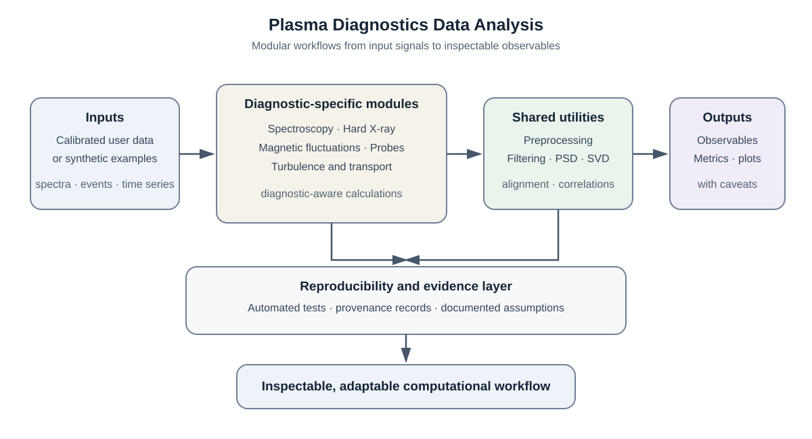
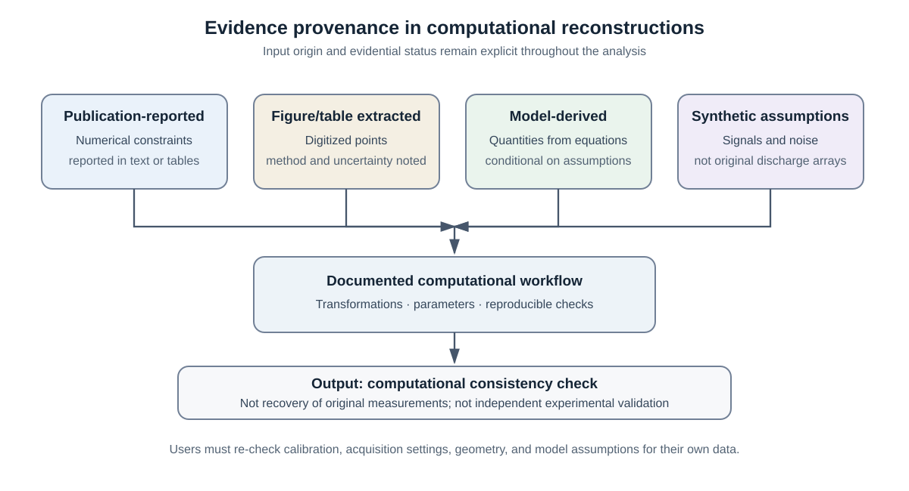

# Plasma Diagnostics Data Analysis: Reproducible Python Workflows for Spectroscopy, Magnetic Fluctuations, X-Ray Signals, and Electrostatic-Probe Analysis

**Ramin Alipour**  
Independent researcher, Tehran, Iran  
Corresponding author: alipour_r@ymail.com  
ORCID: https://orcid.org/0000-0003-0744-9866

## Abstract

Plasma diagnostics produce heterogeneous measurements, including optical spectra, hard X-ray event records, multichannel magnetic signals, and electrostatic-probe time series. Their analysis often relies on separate scripts and notebooks, which can make processing decisions difficult to inspect, reuse, and verify. Plasma Diagnostics Data Analysis is an open-source Python package that organizes reusable analysis workflows across these diagnostic types and related turbulence and transport calculations. It combines shared signal-processing utilities with diagnostic-specific modules, executable notebooks, automated tests, and machine-readable records that document the provenance of publication-derived constraints and synthetic inputs. Six computational case studies based on published IR-T1 tokamak investigations illustrate spectroscopy, hard X-ray and magnetic-signal analysis, compound-probe reconstruction, and transport-related workflows. Dataset A contains supplied laboratory measurements and diagnostic device/software outputs; Dataset B contains values transcribed or reconstructed from published papers, while synthetic inputs are identified separately. Dataset A is not a synthetic or publication-reconstructed dataset. Some Dataset B values can coincide with Dataset A when the publication reports the same underlying experiment; such overlap is not independent validation. The repository does not claim to provide a complete archive of original IR-T1 tokamak shots. The publication-reconstruction cases demonstrate computational procedures and consistency checks; they do not recover original discharges or provide independent experimental validation. The software is intended as an inspectable starting point that researchers can adapt to their own calibrated diagnostic data.

**Keywords:** plasma diagnostics; scientific software; Python; spectroscopy; magnetic fluctuations; signal processing

## Code metadata

| Nr. | Code metadata description | Metadata |
|---|---|---|
| C1 | Current code version | v0.2.2 |
| C2 | Permanent link to code/repository used for this code version | https://github.com/Ramin-Alipour/plasma-diagnostics-data-analysis/releases/tag/v0.2.2 |
| C3 | Permanent link to reproducible capsule | Not available; no Code Ocean or equivalent capsule has been prepared. The public repository provides the source, tests, notebooks, and examples. |
| C4 | Legal code license | MIT License |
| C5 | Code versioning system used | Git |
| C6 | Software code languages, tools, and services used | Python; NumPy; SciPy; pandas; Matplotlib; pytest; Jupyter |
| C7 | Compilation requirements, operating environments, and dependencies | Python ≥3.11; pip; NumPy, SciPy, pandas, and Matplotlib. The package is distributed as a wheel and source distribution; the release workflow tests Python 3.11–3.13. |
| C8 | Link to developer documentation/manual | https://github.com/Ramin-Alipour/plasma-diagnostics-data-analysis/tree/main/docs |
| C9 | Support email for questions | alipour_r@ymail.com |

**Version citation:** Alipour, R. (2026). *Plasma Diagnostics Data Analysis* (Version v0.2.2) [Computer software]. https://doi.org/10.5281/zenodo.23300661.

## 1. Motivation and significance

Experimental plasma diagnostics yield data with different structures and physical meanings: one-dimensional spectra, event-energy records, multichannel magnetic signals, probe time series, and derived turbulence or transport quantities. These data require domain-specific processing, but analysis workflows also share recurring needs: explicit input assumptions, traceable transformations, quantitative outputs, and checks that can be rerun by another researcher. When processing is embedded in one-off scripts or notebooks, it can be difficult to inspect individual steps or adapt them to another instrument.

Plasma Diagnostics Data Analysis addresses this practical problem with a modular collection of Python components and executable examples. The software is motivated by published IR-T1 tokamak studies involving optical spectroscopy, hard X-ray emission and magnetic fluctuations, a compound electrostatic probe, pressure-dependent turbulent transport, biased-limiter experiments, and pressure-dependent MHD activity [1–6]. It does not introduce a new plasma-physics model or claim to provide a universal diagnostic pipeline. Its contribution is the organization of selected analysis operations into inspectable software modules, accompanied by examples, tests, and explicit evidence-provenance records.

A central design principle is to distinguish the evidential status of inputs and outputs. The repository records whether a quantity is reported in a publication, extracted from a table or figure, derived from a stated model, assumed for a synthetic demonstration, or not independently validated. Dataset A consists of the supplied laboratory measurements and diagnostic device/software-output CSVs, including E06 as reported by the owner; these files are preserved as supplied pending provenance review. The E06 file's pixel-coordinate and frequency/amplitude columns do not establish that it is a raw time-domain waveform, so it is not treated as a time-domain PSD input. Dataset B is a separate set of table transcriptions and figure-derived or reconstructed values from published papers. Explicitly synthetic inputs used in selected examples are a third, labelled category—not a description of Dataset A. The two datasets are not silently substituted for each other. For example, the P02 Table 2 transcription in Dataset B coincides numerically with the supplied E02 modal table in Dataset A; this is consistent with both reflecting the same published experiment, so this pair must not be presented as an independent validation comparison. P04 absolute transport/electric-field values and P06 pressure-specific estimates remain explicitly approximate unless source-calibrated re-extraction supports a stronger claim. Table values retain the precision printed in the source; figure digitization reports calibration and uncertainty rather than assuming that two decimal places imply ±0.01 accuracy. The repository does not include a complete archive of original IR-T1 tokamak shots or confidential client data. Publication reconstructions and synthetic demonstrations are not recovered experimental discharges.

## 2. Software description

The package is organized around diagnostic tasks. The `plasma_core` package provides shared data-model and signal-processing utilities, including preprocessing, filtering, spectral calculations, and correlation functions. The `spectroscopy` package includes wavelength calibration, line identification, spectral fitting, and Doppler-broadening calculations. The `hard_xray` package provides event- and spectrum-oriented processing. The `magnetic_diagnostics` package includes multichannel signal analysis, power spectral density (PSD), singular-value decomposition (SVD), wavelet-oriented workflows, and spatial-mode analysis. The `electrostatic_diagnostics` package provides probe-oriented calculations, while `turbulence_transport` supports electric-field, fluctuation, and transport-related analysis. The `cross_diagnostic` package provides time alignment and comparative analysis. Machine-readable provenance records are stored in `plasma_provenance`.

The overall analysis flow is summarized in Fig. 1, and Fig. 2 shows how evidence provenance is represented. The `publication_reconstruction` package contains six computational case studies. Their data and functions are designed to expose the sequence from input constraints and assumptions to a reconstructed observable and a consistency check. Jupyter notebooks provide interactive demonstrations, while pytest tests exercise selected numerical relations, reproducibility, and module behavior. The software uses NumPy and SciPy for numerical computation and signal processing, pandas for tabular data, and Matplotlib for plots.

The cases cover complementary analysis paths:

- **P01 — Optical spectroscopy.** The Dataset A laboratory line-width workflow analyzes supplied raw laboratory measurements/device-software outputs. A separate synthetic line-fitting path is used for software demonstrations and tests. Instrumental-resolution correction follows a documented quadrature model; the real-data and synthetic paths remain distinct.
- **P02 — Hard X-ray and magnetic fluctuations.** Publication-reported event counts and energy summaries constrain a synthetic hard X-ray event set; a synthetic 12-channel magnetic matrix demonstrates modal and spectral analysis. The comparison is descriptive and does not establish causality.
- **P03 — Compound electrostatic probe.** Synthetic directional currents demonstrate the mapping from a current ratio to a Mach-number estimate under the model reported in the source paper.
- **P04 — Pressure-dependent transport.** Synthetic potential and electric-field signals illustrate an analysis chain involving electric-field estimates, E×B-related quantities, and turbulent-transport observables.
- **P05 — Biased limiter.** Parameterized synthetic scenarios demonstrate how limiter position and applied bias can be represented in transport-related comparisons.
- **P06 — Magnetic fluctuations under different pressures.** Synthetic multichannel signals support PSD-based frequency analysis; selected quantities digitized from a published figure are recorded separately with method and uncertainty metadata.

These cases provide breadth, not six independent experimental validations. Synthetic amplitudes, noise, phases, sampling, or other details may be assumptions where the publications do not provide the original arrays or full acquisition metadata. Users must assess the diagnostic response, calibration, geometry, sampling, and physical assumptions before applying any workflow to their own measurements.

## 3. Illustrative use and impact

A user can start with an example spectrum, inspect wavelength calibration and line fitting, apply an instrumental-broadening correction, and calculate a Doppler-temperature estimate. Alternatively, a user can pass a multichannel signal matrix through preprocessing and PSD/SVD operations, or adapt the probe and transport examples to calibrated input arrays. The notebooks make intermediate steps visible, and the tests provide repeatable checks for selected computational behavior. The provenance records and reconstruction documentation connect each publication-derived constraint to its source and distinguish it from synthetic assumptions.

The intended users are researchers and students working with experimental plasma diagnostics who need a starting point for prototyping, comparing, or adapting analysis procedures. Individual modules can be reused without adopting every diagnostic workflow. The MIT license permits reuse subject to its terms.

The project's present impact is evidenced by its public source, documented workflows, automated tests, and traceable computational examples. The manuscript does not claim external adoption, measured time savings, or improved physical inference: those claims would require independent-user studies or tests against separately available experimental datasets. Likewise, the software should not be presented as a replacement for instrument-specific calibration or expert review of diagnostic assumptions.

## 4. Reuse, limitations, and future development

The v0.2.2 release provides installation guidance, module documentation, notebooks, tests, reconstruction notes, and a provenance map. Install the published version from the release artifact or clone the repository at the `v0.2.2` tag; the README documents the development-install command `python -m pip install -e ".[dev]"` and test command `pytest -q`. The immutable tag and version-specific Zenodo DOI identify the software described here.

Several limitations are important. First, Dataset A is a supplied laboratory/device-software dataset, not a complete archive of original IR-T1 tokamak shots; the publication-reconstruction cases therefore cannot recover original discharges. Second, publication tables and figures do not fully specify instrument calibration, acquisition noise, preprocessing, and all geometry or timing details; consequently, some reconstructions are non-unique. In particular, P04 average electric-field powers and radial/poloidal transport values are transcribed from the article's Results/Conclusion text at the authors' reported precision; its maximum-current and steady-state entries remain figure-level estimates. P06 steady-state times are stated in the text, while pressure-specific peak frequencies are aligned with the Figure 2 digitization and rounded to 0.01 kHz with approximately 0.35 kHz uncertainty. The decimal formatting does not imply ±0.01 kHz accuracy. Third, model-based quantities such as probe-derived flow or E×B-related transport depend on assumptions that users must verify for their instruments and operating conditions. Fourth, tests of synthetic data and encoded constraints establish software behavior, not independent experimental validity.

The published v0.2.2 release is the software baseline for this article. Its immutable GitHub tag has a release package containing the source ZIP, Python wheel, source distribution, and SHA-256 checksum file. The release workflow tested and packaged the tagged source; the repository also documents successful test runs across Python 3.11–3.13, installed-wheel checks, and execution of the 15 notebooks on the maintained project state. These checks support software execution, packaging, and repeatability of documented examples. They are not independent experimental validation of the reconstructed physical quantities. All statements in this article refer to the released v0.2.2 feature set, not to subsequent development-branch changes.

Future development could include examples using openly available experimental datasets, stronger input validation, independent-user usability feedback, and comparisons with independently documented reference outputs. These steps would broaden the evidence for portability and usefulness without changing the current boundary between synthetic demonstration and experimental validation.

## 5. Conclusions

Plasma Diagnostics Data Analysis is an open-source Python package for organizing inspectable computational workflows across spectroscopy, hard X-ray signals, magnetic fluctuations, electrostatic probes, and turbulence- and transport-related analysis. Its contribution is the combination of reusable diagnostic modules, executable examples, automated checks, and explicit evidence provenance. Six publication-grounded case studies demonstrate how selected procedures can be represented computationally while distinguishing supplied laboratory data (Dataset A), publication-derived reconstructions (Dataset B), and synthetic test inputs. The article describes the immutable v0.2.2 release and does not claim that its computational demonstrations recover unavailable raw tokamak shots or independently validate the underlying physical results.

## Acknowledgements

No acknowledgements are proposed in this draft. Confirm whether any individuals or organizations should be acknowledged before submission.

## CRediT authorship contribution statement

Ramin Alipour: Conceptualization, Methodology, Software, Validation, Formal analysis, Data curation, Visualization, Writing – original draft, Writing – review and editing. **Author verification required:** confirm that this contribution statement accurately reflects the work and that no other contributor meets the journal's authorship criteria.

## Declaration of competing interest

Draft statement: The author declares no known competing financial interests or personal relationships that could have appeared to influence the work. Confirm before submission.

## Funding

Draft statement: This work received no specific grant from any funding agency in the public, commercial, or not-for-profit sectors. Confirm before submission; replace if any funding or material support applies.

## Data availability

Dataset A provides supplied raw laboratory measurements and diagnostic device/software outputs. Dataset B contains publication-extracted or publication-reconstructed data, while synthetic inputs are identified explicitly in the relevant examples. The repository does not provide a complete archive of original IR-T1 tokamak discharges; this limitation does not mean that Dataset A is synthetic or publication-derived.

## Figure captions

**Figure 1. Software workflow and package architecture.** Diagnostic-specific modules use shared preprocessing and analysis utilities to transform user-supplied or demonstration inputs into derived observables and plots. Tests and provenance records support inspection and repeatability. Publication-grounded examples use documented constraints and synthetic signals where original measurements are unavailable. Editable source: `docs/softwarex/figures/figure1_software_workflow.svg`.

**Figure 2. Evidence provenance in the reconstruction cases.** The diagram distinguishes publication-reported constraints, values extracted from tables or figures, model-derived quantities, and synthetic assumptions. The resulting computations are consistency demonstrations, not recovery of original IR-T1 measurements or independent experimental validation. Editable source: `docs/softwarex/figures/figure2_evidence_provenance.svg`.

## Software availability

Repository and release: https://github.com/Ramin-Alipour/plasma-diagnostics-data-analysis/releases/tag/v0.2.2. Version-specific archival record: https://doi.org/10.5281/zenodo.23300661. License: MIT.

## References

[1] R. Alipour, M. Ghoranneviss, A. Salar Elahi, “First investigation on plasma impurities of the IR-T1 tokamak,” *AIP Advances* 7 (2017) 115303. https://doi.org/10.1063/1.4990869.

[2] R. Alipour, M. Ghoranneviss, A. Salar Elahi, “Investigation on the Hard X-ray Radiations of the IR-T1 Tokamak Plasma: Electric and Magnetic Perspectives,” *Brazilian Journal of Physics* 47 (2017) 567–574. https://doi.org/10.1007/s13538-017-0536-6.

[3] R. Alipour, M. Ghoranneviss, A. Salar Elahi, “Design and fabrication of a new compound probe for plasma flux measurement in IR-T1 tokamak,” *Review of Scientific Instruments* 88 (2017) 093516. https://doi.org/10.1063/1.4994037.

[4] R. Alipour, S. Meshkani, A. Salar Elahi, M. Ghoranneviss, “Investigation on the effect of pressure on turbulent transports of the IR-T1 Tokamak plasma,” *The European Physical Journal D* 71 (2017) 60. https://doi.org/10.1140/epjd/e2017-70563-6.

[5] R. Alipour, M. Ghoranneviss, A. Salar Elahi, S. Meshkani, “Effects of the location of a biased limiter on turbulent transport in the IR-T1 tokamak plasma,” *The European Physical Journal D* 71 (2017) 228. https://doi.org/10.1140/epjd/e2017-80215-6.

[6] R. Alipour, M. R. Ghanbari, “Magnetic evaluation of hydrogen pressures changes on MHD fluctuations in IR-T1 tokamak plasma,” *The European Physical Journal D* 72 (2018) 75. https://doi.org/10.1140/epjd/e2018-90033-y.
