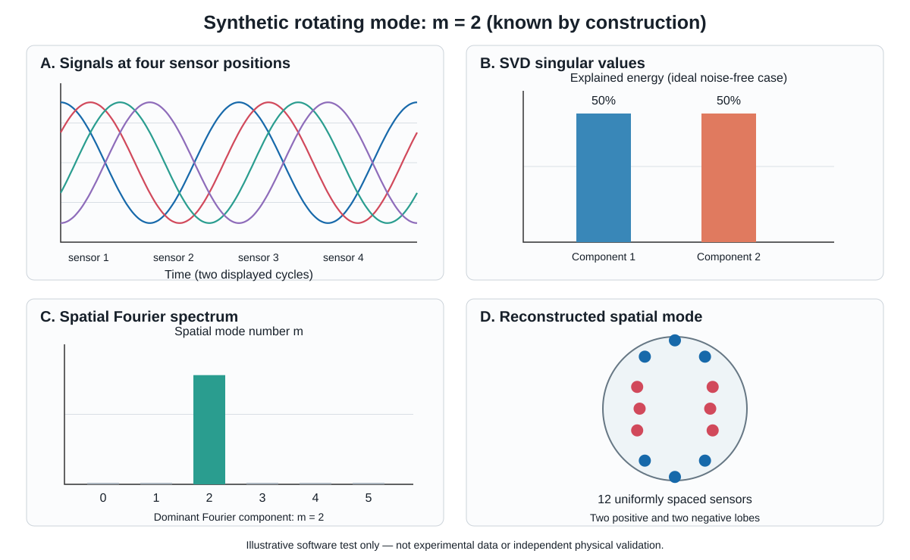

# Plasma Diagnostics Data Analysis: A Provenance-Aware Python Framework for Reproducible Diagnostic Workflows

**Author:** Ramin Alipour  
**ORCID:** https://orcid.org/0000-0003-0744-9866  
**Corresponding author:** alipour_r@ymail.com

## Abstract

Experimental plasma diagnostics produce heterogeneous signals and spectra that require calibration, preprocessing, feature extraction, and quantitative interpretation. When analysis is distributed across one-off scripts, it is difficult to reuse methods, inspect intermediate calculations, trace values to their sources, or distinguish measured data from derived and synthetic quantities. *Plasma Diagnostics Data Analysis* is an open-source Python framework for spectroscopy, hard-X-ray signals, magnetic fluctuations, electrostatic probes, turbulence and transport, and cross-diagnostic analysis. It combines reusable modules with executable notebooks, automated tests, source manifests, and field-level provenance records. Six publication-grounded IR-T1 case workflows (P01–P06) are included. Dataset A contains the author's supplied laboratory and diagnostic-software records; Dataset B contains separately documented values transcribed, digitized, or reconstructed from publications; synthetic signals form a third category used for controlled demonstrations and software tests. The repository records source and field provenance but does not impose a universal static type system that makes every cross-class operation impossible; users must inspect provenance and the documented case boundaries. The v0.2.2 archive is available from GitHub and Zenodo. Its CI tested Python 3.11–3.13, executed reconstruction notebooks on Python 3.11, and built and tested an installed wheel. These checks support reproducible software execution, not independent validation of historical experimental results.

**Keywords:** plasma diagnostics; scientific software; Python; spectroscopy; magnetic fluctuations; signal processing; data provenance

**Highlights**

- Reusable workflows span six IR-T1 diagnostic-analysis case studies.
- Field-level provenance separates supplied, publication-derived, and synthetic data.
- Source discrepancies are preserved rather than adjusted to force agreement.
- Tests verify software behavior, not independent experimental validity.

## 1. Motivation and significance

Plasma-diagnostic analysis is not a single calculation. It typically combines preprocessing, calibration, feature extraction, signal analysis, calculation of physical observables, and comparison with experimental or published constraints. When these steps are scattered across individual scripts and notebooks, researchers may have to reimplement methods, and it becomes harder to inspect intermediate results, trace a value to its source, reproduce a workflow, or identify where a disagreement enters the analysis. Reproducing a published plot alone does not solve these problems.

*Plasma Diagnostics Data Analysis* addresses this software-engineering gap by organizing six publication-grounded IR-T1 cases (P01–P06) into reusable Python workflows spanning optical/Doppler spectroscopy and impurity analysis [1], hard-X-ray observations [2], compound-probe measurements [3], pressure-dependent turbulent transport [4], biased-limiter effects [5], and magnetic/MHD fluctuations [6]. The purpose is not to claim new IR-T1 experiments or to recover unavailable original shots. It is to make selected methods executable and inspectable, preserve the distinction between source data and reconstructed or synthetic inputs, and provide explicit checks for source consistency and software behavior.

The contribution is therefore not the act of reproducing six papers in isolation. It is the combination of diagnostic-specific algorithms, reusable interfaces, runnable examples, automated regression checks, and field-level provenance that lets users inspect how each result was produced. The evidence model distinguishes source-reported values, table transcriptions, figure digitizations, reconstructed values, synthetic inputs, assumptions, and derived quantities. Crucially, it preserves genuine discrepancies instead of forcing agreement: a detected mismatch can trigger investigation, whereas silently editing one dataset to match another would make the workflow less trustworthy. Software tests establish defined computational behavior; they do not, by themselves, establish independent physical validity.

### 1.1. Related software and scope

Established tools address complementary parts of plasma-diagnostic analysis. PlasmaPy includes a Langmuir-probe diagnostics module, so its functionality directly overlaps with the electrostatic-probe area of this package [8]. OMFIT supports integrated modelling workflows and data exchange [9], while MDSplus provides experimental data acquisition, storage, and access infrastructure [10]. The package described here is not a replacement for these tools and no systematic performance benchmark has been conducted.

| Capability | PlasmaPy | OMFIT | MDSplus | This package |
|---|---|---|---|---|
| General plasma-physics utilities | Broad Python functionality | Available through integrated workflows | Not its primary purpose | Not a general replacement |
| Langmuir-probe analysis | Dedicated diagnostics module; direct overlap | Depends on workflow/plugins | Stores/accesses experimental data | Selected electrostatic and compound-probe workflows |
| Experimental data infrastructure | Not its primary purpose | Can interface with data sources | Core strength: access and storage | Does not replace acquisition/archive infrastructure |
| Integrated equilibrium/modelling workflows | Not its primary purpose | Core strength | Not its primary purpose | Out of scope |
| P01–P06 IR-T1 publication-grounded cases | No claim of equivalent bundled case set | No claim of equivalent bundled case set | No claim of equivalent bundled case set | Explicit examples and source-comparison records |
| Field-level provenance separating Dataset A, Dataset B, and synthetic inputs for these cases | Not assessed here | Not assessed here | Not assessed here | Explicitly implemented for the included records |

The distinguishing contribution is therefore case-specific rather than a claim that basic plasma calculations are unique: the package bundles selected IR-T1 calculations with field-level source provenance, executable reconstruction examples, and discrepancy-preserving audit checks. In particular, the Langmuir-probe functionality overlaps with PlasmaPy; users should choose based on whether they need PlasmaPy's broader reusable API or this repository's specific case records and provenance trail. No feature-by-feature audit of all versions of these external projects has been performed.
## 2. Software description

### 2.1. Architecture and capabilities

The package provides reusable components for:

- **Optical spectroscopy:** wavelength calibration, line identification, Gaussian fitting, and Doppler-broadening calculations.
- **Magnetic diagnostics:** signal preprocessing, power spectral density (PSD), singular-value decomposition (SVD), wavelet-based time-frequency analysis where implemented, and spatial Fourier-mode projections.
- **Electrostatic probes:** probe-oriented calculations and compound-probe flow/Mach-number analysis.
- **Hard-X-ray analysis:** event summaries and energy-spectrum calculations for available tabulated or synthetic inputs; raw detector events and detector-response calibration are not available for independent reconstruction.
- **Turbulence and transport:** fluctuation statistics, electric-field and E×B-related quantities, Reynolds stress, turbulent-flux calculations, and parameter scans.
- **Cross-diagnostic analysis:** time alignment, correlation, and comparative summaries.
- **Reconstruction and provenance:** source manifests, field-level provenance, dataset loaders, audit records, and comparison utilities.

The repository contains reusable package modules, domain notebooks, six publication-reconstruction cases, a dedicated Dataset A P01 laboratory line-width notebook, tests, package metadata, and audit documentation. The published v0.2.2 dependency constraints are Python ≥3.11, NumPy ≥1.26, SciPy ≥1.11, Matplotlib ≥3.8, and pandas ≥2.1; development extras include pytest ≥8 and Jupyter ≥1. The release CI matrix covers Python 3.11, 3.12, and 3.13 on the configured GitHub-hosted runner environment; the notebooks are executed on Python 3.11. Windows and macOS are not claimed as tested platforms.

### 2.2. Evidence classes and dataset boundaries

Three evidence classes are maintained separately.

**Dataset A — supplied laboratory and diagnostic-software records.** This set contains a limited collection of owner-supplied laboratory measurements and diagnostic-software outputs. Source records are retained without numerical alteration. Dataset A is not a complete archive of original IR-T1 discharge data. The owner identifies e06_mhd_signal.csv as a diagnostic-software export; its columns (x_pixel, y_pixel, frequency_kHz, and amplitude) do not establish that it is a raw time-domain waveform, so the software does not calculate a time-domain PSD from it without valid waveform and sampling metadata.

**Dataset B — publication-derived records.** This set contains values transcribed from tables or text, digitized from figures, or reconstructed from six IR-T1 publications [1–6]. Source manifests and column-level provenance distinguish exact reported values from approximate digitizations and reconstructed quantities. Dataset B is not Dataset A with noise added.

**Synthetic data — controlled computational inputs.** Synthetic signals exercise algorithms or encode selected constraints. Noise settings are workflow-specific, not a package-wide convention. One synthetic relative-noise test uses a Gaussian perturbation with standard deviation set to 1.3% of the absolute nonzero reference value; exact zero references remain zero. Separately, the turbulence-fluctuation generator defaults to `noise_fraction = 0.01` (1%). These are configurable software-test/demo settings, not estimates of instrument noise or values inferred from experimental statistics. The 1.3% setting is a chosen test parameter, not an empirically justified noise model; conclusions that depend on it must be checked across noise levels before it is used for scientific inference. The setting applies only to synthetic inputs and does not alter Dataset A or Dataset B.

Several source boundaries are particularly important. For P01, the lead author supplied laboratory measurements that are kept separate from the publication-derived record. The accompanying provenance note states that some publication values were intentionally approximate or different to protect sensitive diagnostic know-how; this explanation has not been independently verified by the software. Accordingly, the records are not treated as interchangeable, and the publication-derived values are not used to overwrite the supplied measurements. Dataset A consists of the author's own laboratory experimental results and associated diagnostic-software outputs. The repository's MIT license applies to code, not automatically to data. Dataset A currently has no separate data-reuse license in the repository. The paper does not assert that coauthors or former institutions have approved reuse; the author must confirm any applicable institutional, collaborator, and data-owner permissions before submission. Dataset B contains numerical transcriptions, digitizations, and reconstructions rather than reproductions of the publishers' original figures; neither the software license nor the repository grants rights to copyrighted source publications. The early synthetic CCD-like spectrum was a software-development scaffold, not the experimental dataset; comparisons between that scaffold and publication temperatures are withdrawn from scientific reporting and are not reported as experimental discrepancies. For P02, the Dataset A modal table and the Dataset B transcription of the published table coincide numerically; that overlap is preserved because the two records have different provenance roles, and it is not independent validation. For P04, Dataset A records +0.0010 for radial transport at 2.3 Torr under +200 V, while the source paper text reports −0.0011. The discrepancy remains unresolved in this software paper: no raw acquisition record or contemporaneous laboratory notebook was available in the audited materials to establish which value is correct, and the two values are retained with their provenance rather than silently adjusted. The paper does not imply that the discrepancy is a confirmed experimental effect or a corrected published result. For P06, the digitized pressure-specific PSD peaks are approximate (about 42, 48, and 52 kHz). The source record gives ±0.35 kHz for axis calibration and ±0.02 in digitized amplitude; the separately reported ±3.1 kHz peak-selection allowance is a conservative manual estimate, not an uncertainty propagated from pixel resolution and a formal peak-localization model. Therefore ±3.1 kHz is reported only as a provisional digitization allowance, not as a statistical confidence interval or a validated error bar. Panel-level differences must be reported numerically without using this allowance to declare agreement where the differences exceed it. These comparisons do not justify treating a digitized curve as a raw time series or forcing agreement with a paper's broader frequency band.

### 2.3. Publication-grounded computational cases

The six cases illustrate different computational paths:

| Case | Domain and demonstration | Main limitation |
|---|---|---|
| P01 | Spectral-line fitting and Doppler-related calculations; separate laboratory-data analysis | Synthetic fitting is a software test, not the experimental spectrum |
| P02 | Hard-X-ray event-energy summaries, synthetic multichannel magnetic signals, and spatial Fourier modes | Original detector response and raw Mirnov time series are unavailable |
| P03 | Directional-current model and Mach-number sensitivity analysis | Original collector-current time series is unavailable |
| P04 | Potential-to-field and transport calculations under pressure and bias conditions | Some intermediate traces are synthetic; reconstructed values are labelled approximate |
| P05 | Parameterized limiter-position and bias scenarios | Scenarios are consistency demonstrations, not new measurements or independent causal inference |
| P06 | Synthetic multichannel fluctuations, PSD analysis, and selected figure digitization | Figure-derived peaks are approximate; pressure-specific comparisons in panels b/c exceed the stated uncertainty |

Synthetic traces are not described as recovered measurements. Agreement with a target used to construct a synthetic signal is a computational consistency check, not independent experimental validation. The software does not infer a physical poloidal mode number merely from an SVD component index.

## 3. Methods and illustrative use

The implementation uses established numerical methods rather than proposing new physical estimators. Table 1 summarizes the principal calculations, assumptions, and limits; the equations below specify representative calculations used in the workflows.


**Table 1. Methods, assumptions, and limitations**

| Method | Calculation used | Principal assumptions | Limitation in this package |
|---|---|---|---|
| Gaussian line fit | \(I(\lambda)=A\exp[-(\lambda-\lambda_c)^2/(2\sigma^2)]\) | One isolated Gaussian peak; baseline treated separately | No automatic multi-line, opacity, Stark, Zeeman, or instrument line-spread model |
| Doppler-equivalent temperature | \(T_i=(mc^2/ k_B) (\sigma_D/\lambda_0)^2\) in kelvin, or divide energy by \(e\) for eV | Maxwellian thermal velocity distribution; Gaussian Doppler profile; independent Gaussian instrumental width removed in quadrature | Result is only a Doppler-equivalent estimate unless non-thermal broadening and line blending are negligible or modelled |
| PSD | Discrete Fourier/spectral-density estimate via the repository's shared signal-processing function | Correct sampling frequency, approximately stationary segment, adequate record length and no aliasing | A peak from a synthetic signal is a software check; raw E06 pixel/frequency/amplitude exports are not time series |
| SVD | \(X=U\Sigma V^{\mathsf T}\), \(p_i=\sigma_i^2/\sum_j\sigma_j^2\) | Matrix orientation is channels × time; preprocessing is stated explicitly | Component index is not itself a physical mode number; mean removal changes the matrix reconstructed by the current result object |
| Spatial Fourier projection | \(a_m(t)=N^{-1}\sum_j x_j(t)e^{-im\theta_j}\) | Sensor angles known and sufficiently uniform; geometry and toroidal/poloidal interpretation justified | Nonuniform sensor spacing, missing channels, geometry errors, and toroidal effects can bias mode estimates |
| Compound-probe reduced model | \(R=I_{\mathrm{up}}/I_{\mathrm{down}}\), \(M=\ln(R)/K\) | Positive directional currents and a geometry/condition-specific calibration factor \(K\) | P03 is a model-constrained reconstruction; no independent raw collector-current time series is available |
| E-field and transport chain | Finite-difference potential gradient, ideal \(\mathbf E\times\mathbf B\) drift, then fluctuation products | Coordinate convention, field direction, units, and spatial/temporal alignment are consistent | P04/P05 intermediate synthetic traces were constructed for comparison with published constraints; this is not independent validation |

For Gaussian Doppler broadening, the equivalent width relation is
a Gaussian line whose width is attributed to thermal Doppler broadening after accounting for instrumental broadening, the emitter temperature is related to the Doppler full width at half maximum (FWHM) by [11]

\[
\Delta\lambda_D = \frac{\lambda_0}{c}
\sqrt{\frac{8 k_B T \ln 2}{m}}, \qquad
T = \frac{m c^2}{8 k_B \ln 2}
\left(\frac{\Delta\lambda_D}{\lambda_0}\right)^2 .
\]

This relation assumes that the fitted width can be assigned to thermal Doppler broadening after instrumental broadening is corrected or negligible. Instrumental broadening, Stark broadening, Zeeman splitting, and self-absorption (opacity) can all alter a measured profile. The current workflow fits the supplied profile and calculates a Doppler-equivalent temperature; it does not independently model Stark or Zeeman profiles, radiative transfer/self-absorption, or an instrument line-spread function. Consequently, the returned temperature is not physically validated unless those effects are negligible or corrected externally [11].

For a multichannel magnetic matrix \(X\in\mathbb{R}^{N_c\times N_t}\), the SVD workflow first optionally subtracts each channel mean and then computes

\[
X = U\Sigma V^{\mathsf T}.
\]

The fraction of squared-singular-value energy assigned to component \(i\) is

\[
p_i = \frac{\sigma_i^2}{\sum_j \sigma_j^2}.
\]

The component index identifies an SVD component, not by itself a physical poloidal mode number. A separate spatial projection or phase-based mode-identification procedure and appropriate sensor geometry are needed for that interpretation [12,14].


### 3.1. Provenance record and data-class boundaries

The machine-readable provenance index is JSON and is represented by the repository's `ProvenanceRecord` schema. Each record contains an identifier, paper and source locator, source type, quantity, reported value and unit, extraction and reconstruction methods, assumptions, model assumptions, reconstructed value, uncertainty, relative error, and a limitation statement. For example, a P04 record is represented as follows:

```json
{
  "record_id": "P04-1.9Torr",
  "source_paper": "P04",
  "source_locator": "Pressure 1.9 Torr; Text/Conclusion",
  "source_type": "reported_range",
  "quantity": "radial_turbulent_transport",
  "reported_value": 0.0066,
  "unit": "publication units as encoded in source CSV",
  "extraction_method": "direct constraint extraction",
  "reconstruction_method": "potential → E → E×B → turbulent flux",
  "assumptions": ["reported radial transport constraint", "synthetic potential fluctuations"],
  "model_assumptions": ["linear finite-difference E-field and ideal E×B drift"],
  "reconstructed_value": 0.006599999999999957,
  "uncertainty": 0,
  "relative_error_pct": 0,
  "limitation": "Intermediate measurement traces are synthetic; target is an explicit publication constraint."
}
```

The zero residual in this example is a consequence of constructing synthetic intermediate values to meet the selected published target. It is not a measurement uncertainty, a confidence interval, or an independent validation result. The provenance schema is project-specific JSON; the repository includes `CITATION.cff), but the provenance records are not claimed to be a conformant W3C PROV, RO-Crate, or CodeMeta implementation. Dataset manifests record source paths and Git blob fingerprints, and CI checks the listed file bytes in the tested source tree. A fingerprint detects an undocumented change relative to a known manifest; without a trusted external signature, it does not authenticate who created the file or protect against an attacker who can alter both file and manifest. The current pipeline documents data classes and provenance, but it does not provide a universal runtime rule that prevents every possible operation mixing Dataset A, Dataset B, and synthetic arrays. The examples and audit scripts preserve the distinction by convention and explicit checks, and users remain responsible for maintaining it in new workflows.

### 3.2. Numerical regression checks and API map

The v0.2.2 test suite includes known-answer or controlled-input assertions for the core calculations. The Gaussian fit test recovers the temperature used to generate a synthetic spectrum to within 3%; the Doppler conversion round-trip recovers a specified 20 eV case to a relative tolerance of 10⁻¹²; the magnetic PSD test places the strongest synthetic spectral peak within 200 Hz of the generator's 44 or 70 kHz components; the SVD tests verify the channels-by-time orientation, reconstruction of the centered matrix, and normalized explained energy. These tests use controlled synthetic inputs and are regression checks, not tests against independent experimental ground truth. The package does not claim a Parseval-theorem regression test, a comparison against a second independent fitting implementation, or a reported line/branch coverage percentage for this manuscript. The Gaussian fitter uses SciPy's `curve_fit` internally, so this is not an independent comparison against SciPy.

| API area | Representative public function or object | Input and output role |
|---|---|---|
| Spectral fitting | `spectroscopy.spectral_fitting.gaussian.fit_gaussian_peak` | Wavelength/intensity arrays → Gaussian parameters, covariance, and residuals |
| Doppler estimate | `spectroscopy.doppler_broadening.temperature.estimate_doppler_temperature` | Line centre, observed width, mass, optional instrumental width → temperature in eV/K |
| Magnetic PSD | `magnetic_diagnostics.fft_psd.channel_psd` | Multichannel data and sampling frequency → frequency grid and PSD |
| SVD | `magnetic_diagnostics.svd.compute_svd` | Channels × time matrix → singular vectors, singular values, explained energy |
| Provenance | `plasma_provenance.schema.ProvenanceRecord`, `load_records` | Source and reconstruction metadata → serializable, inspectable JSON records |
| Dataset comparison | `plasma_provenance.dataset_comparison.compare_dataset_a_b` | Selected A/B source tables → field-level comparison report |

The code examples below are minimal diagnostic examples. A single API table is not evidence that all modules have been independently validated; the published tests and case-specific boundaries define the supported scope.

A reproducible synthetic example can test whether the workflow preserves a known rotating spatial mode. For uniformly spaced sensors at angles \(\theta_j\), construct \(x_j(t)=\cos(m\theta_j-2\pi f t)\) with known mode number \(m=2\). Over an integer number of temporal periods, the cosine and sine quadratures have equal energy, so the first two SVD singular values should be approximately equal. Because this two-dimensional subspace is degenerate, an individual SVD spatial vector is not uniquely the physical mode; the mode number is recovered separately by projection onto the known spatial Fourier basis.

```python
import numpy as np
from magnetic_diagnostics.svd import compute_svd

n_channels, n_samples = 12, 1024
fs_hz, f_hz, m_true = 256_000.0, 12_000.0, 2
theta = 2 * np.pi * np.arange(n_channels) / n_channels
time_s = np.arange(n_samples) / fs_hz

# One rotating mode, sampled over 48 complete periods.
signals = np.cos(
    m_true * theta[:, None] - 2 * np.pi * f_hz * time_s[None, :]
)
result = compute_svd(signals, center=True, scale=False)

relative_singular_values = result.singular_values[:2] / result.singular_values[0]
explained_energy = result.explained_energy[:2]

# Recover the spatial Fourier mode independently of the SVD basis orientation.
spatial_coefficients = np.fft.fft(signals, axis=0) / n_channels
mode_power = np.mean(np.abs(spatial_coefficients) ** 2, axis=1)
m_recovered = int(np.argmax(mode_power[1:n_channels // 2]) + 1)

# SVD reconstruction is in the centered/scaled analysis space.
centered_reconstruction = result.reconstruct(n_components=2)
```

For this noise-free construction, the first two singular values and explained-energy fractions should be equal to numerical precision, and the spatial Fourier projection should recover \(m=2\). This is a controlled algorithmic check, not experimental validation. In particular, `SVDResult.reconstruct()` reconstructs the matrix passed to SVD after the requested centering/scaling; with the default `center=True`, it returns the centered signal, not the original signal including each channel's mean. The `SVDResult` object does not store the removed per-channel means or scale factors. To reconstruct the original matrix, the caller must retain those values before analysis, add the means back, and undo any scaling explicitly.



*Figure 1. Synthetic rotating-mode demonstration. The known mode number is imposed by construction; SVD recovers a two-dimensional coherent subspace, while spatial Fourier projection identifies \(m\). This figure demonstrates software behavior, not an experimental result.*


For directional probe currents, a common reduced relation is \(R=I_{\mathrm{up}}/I_{\mathrm{down}}\) and \(M=\ln(R)/K\), where the calibration factor \(K\) depends on probe geometry and plasma conditions [13]. The package's P03 case is a model-constrained reconstruction; it is not a calibration of an independent raw-current series.

A typical end-to-end workflow loads a dataset using provenance-aware functions, checks its source manifest and field-level records, applies reusable analysis functions, compares outputs only with relevant source constraints, and runs the corresponding tests or notebook. The P01 laboratory notebook analyzes supplied measurements separately from synthetic line-fitting tests. For magnetic/MHD examples, a multichannel matrix is analyzed with SVD/PSD and, where justified by geometry and input metadata, spatial Fourier projections. For turbulence/transport examples, parameterized inputs demonstrate the calculation chain while reported text values remain separate from approximate reconstructions. Intermediate steps are available for inspection, and source records remain traceable through manifests and provenance metadata.

## 4. Impact, verification, and limitations

The practical impact is that researchers can reuse selected diagnostic-analysis components, inspect intermediate calculations, and rerun six case workflows within one versioned software distribution. The software includes six publication-grounded case workflows (P01–P06); this is a description of scope, not a numerical validation score. The source-comparison checks illustrate why the distinction matters: P01, P02, and P03 contain exact overlaps with publication tables or reported parameters, which are source-consistency checks rather than independent validation; P04 preserves a source discrepancy in one of 30 shared-field comparisons; P05 checks both direction and magnitude for four reported effects; and P06 distinguishes reported timing constraints from approximate figure-digitized frequency estimates. These outcomes make the scope and limits of each comparison visible. The shared-field count is descriptive bookkeeping only; it is not an inferential statistic and is not used as a measure of scientific validity. The project does not claim external adoption, quantified time savings, or improved physical inference; those claims would require independent-user studies or validation against separately documented experimental datasets. The software's current I/O is based primarily on the repository's tabular records and arrays; native HDF5, NetCDF, MDSplus, or IMAS adapters and a cross-device benchmark are not claimed. Its intended scope is a provenance-aware case-workflow package, not a general-purpose experimental data infrastructure.

The cited software version is archived as v0.2.2 [7]. Continuous integration on the released source commit `5fa9b58b43b3461135404ef84db7bd434a31e5c4` passed on Python 3.11, 3.12, and 3.13. The Python 3.11 job executed the reconstruction notebooks; all three jobs completed tests, compilation, import checks, and installed-wheel checks. The corresponding CI run is [38174480297](https://github.com/Ramin-Alipour/plasma-diagnostics-data-analysis/actions/runs/38174480297). The release-packaging workflow passed, built the source distribution and wheel, created the source ZIP and checksum file, and attached the four assets to the GitHub release [run 38174480392](https://github.com/Ramin-Alipour/plasma-diagnostics-data-analysis/actions/runs/38174480392). The CI matrix reported here does not establish Windows/macOS support, notebook execution outside Python 3.11, or code coverage. The archived workflow is the evidence for the release; it is not evidence that every manuscript-only clarification is present in the archive.

The manuscript and its illustrative text have been revised on the repository's development branch, but those edits do not change the immutable v0.2.2 archive. The reported release tests apply to source commit `5fa9b58b43b3461135404ef84db7bd434a31e5c4`; claims about tests or files added after that commit are not attributed to the archived release.

These checks establish software execution, packaging, and selected computational consistency. They do not independently validate historical IR-T1 measurements, verify unavailable acquisition logs, recover missing raw shots, or convert synthetic constraints into new experimental findings. Dataset B values digitized from figures or reconstructed from incomplete publication information may be approximate. For P06, the table-based pressure-frequency comparison and the separate comparison with digitized Figure 2 peaks are different checks and must not be conflated; both retain their respective differences. The approximate ±3.1 kHz combined axis-calibration and peak-selection uncertainty follows the repository's digitization record; it should not be interpreted as a statistical confidence interval, and its peak-selection component is a conservative estimate rather than a formal probabilistic uncertainty budget. Dataset A is a limited supplied record set rather than a full acquisition archive, and confidential client datasets are not distributed.

## 5. Conclusions

*Plasma Diagnostics Data Analysis* provides six implemented and assessed publication-grounded case workflows (P01–P06) across major plasma-diagnostic analysis domains. Its main contribution is not simply reproducing previously published numbers or plots, but packaging reusable analysis procedures with runnable examples, regression checks, and explicit provenance for source-reported, transcribed, digitized, reconstructed, derived, and synthetic values. The case audits show that numerical agreement is not universal and should not be manufactured: one P04 source discrepancy is retained, and P06 figure-derived frequency differences remain explicitly approximate. Together with automated execution and packaging checks, this gives users a more inspectable basis for reusing and adapting diagnostic workflows. The current evidence supports claims of software coverage, reproducible execution, and documented consistency checks—not independent validation of historical measurements or new experimental discoveries.

## Software availability and metadata

| Code metadata | Description |
|---|---|
| Current code version | 0.2.2 |
| Permanent link to the code version | https://github.com/Ramin-Alipour/plasma-diagnostics-data-analysis/releases/tag/v0.2.2 |
| Version-specific archive DOI | https://doi.org/10.5281/zenodo.23300661 |
| Repository | https://github.com/Ramin-Alipour/plasma-diagnostics-data-analysis |
| Legal code license | MIT |
| Versioning system | Git |
| Language and tools | Python; NumPy, SciPy, Matplotlib, pandas; pytest and Jupyter for development/testing |
| Requirements and environment | Python ≥ 3.11; CI on Python 3.11–3.13; notebook execution on Python 3.11 |
| Documentation | https://github.com/Ramin-Alipour/plasma-diagnostics-data-analysis |
| Support contact | alipour_r@ymail.com |

**Installation:** `python -m pip install "plasma-diagnostics-data-analysis @ https://github.com/Ramin-Alipour/plasma-diagnostics-data-analysis/releases/download/v0.2.2/plasma_diagnostics_data_analysis-0.2.2-py3-none-any.whl"`  
**Verify a downloaded release asset:** run `sha256sum -c SHA256SUMS.txt` in the directory containing the asset and the release checksum file (use the platform's equivalent checksum utility where `sha256sum` is unavailable). The checksum file is distributed with the assets but is not digitally signed; it detects accidental corruption only if the checksum file itself is trusted.  
**Tests from a source checkout:** `python -m pip install -e ".[dev]" && python -m pytest`

## CRediT authorship contribution statement

Ramin Alipour: Conceptualization, Software, Methodology, Formal analysis, Data curation, Visualization, Writing – original draft, Writing – review and editing.

## Declaration of competing interest

The author declares no known competing financial interests or personal relationships that could have appeared to influence the work reported in this paper.

## Funding

The author must confirm the funding statement before submission. No funding source is asserted in this draft.

## Declaration of generative AI and AI-assisted technologies in the manuscript preparation process

During the preparation of this manuscript, the author used ChatGPT (OpenAI) to assist with drafting, organization, and language editing. The author reviewed and edited the manuscript and takes full responsibility for its content.

## Data availability

The source code is released under the MIT license. The public repository contains source manifests, provenance records, and selected data records. The version-specific Zenodo DOI identifies the published v0.2.2 archive; subsequent source-tree manuscript clarifications are not incorporated into that archived snapshot. Dataset A consists of the author's laboratory measurements and associated diagnostic-software outputs, not a complete archive of original IR-T1 raw shots. Dataset B contains selected numerical values transcribed, digitized, or reconstructed from cited publications. The repository does not distribute original publisher figures or claim rights over source publications. The MIT license applies to code, not automatically to data; [DATA_TERMS.md](../DATA_TERMS.md) states that no separate reuse license has been specified for Dataset A. The author must confirm applicable permissions for public release and reuse of Dataset A, including any institutional or collaborator conditions, before submission. Confidential client datasets are not included.

## Acknowledgements

The author must confirm before submission whether any acknowledgements are required.

## References

1. Alipour, R., Ghoranneviss, M., & Elahi, A. S. (2017). First investigation on plasma impurities of the IR-T1 Tokamak. *AIP Advances*, 7(11), 115303. https://doi.org/10.1063/1.4990869
2. Alipour, R., Ghoranneviss, M., & Elahi, A. S. (2017). Investigation on the Hard X-ray Radiations of the IR-T1 Tokamak Plasma: Electric and Magnetic Perspectives. *Brazilian Journal of Physics*, 47, 567–574. https://doi.org/10.1007/s13538-017-0536-6
3. Alipour, R., Ghoranneviss, M., & Elahi, A. S. (2017). Design and fabrication of a new compound probe for plasma flux measurement in IR-T1 tokamak. *Review of Scientific Instruments*, 88, 093516. https://doi.org/10.1063/1.4994037
4. Alipour, R., Meshkani, S., Elahi, A. S., & Ghoranneviss, M. (2017). Investigation on the effect of pressure on turbulent transports of the IR-T1 Tokamak plasma. *The European Physical Journal D*, 71, 60. https://doi.org/10.1140/epjd/e2017-70563-6
5. Alipour, R., Ghoranneviss, M., Elahi, A. S., & Meshkani, S. (2017). Effects of the location of a biased limiter on turbulent transport in the IR-T1 tokamak plasma. *The European Physical Journal D*, 71, 228. https://doi.org/10.1140/epjd/e2017-80215-6
6. Alipour, R., & Ghanbari, M. R. (2018). Magnetic evaluation of hydrogen pressure changes on MHD fluctuations in IR-T1 tokamak plasma. *The European Physical Journal D*, 72, 75. https://doi.org/10.1140/epjd/e2018-90033-y
7. Alipour, R. *Plasma Diagnostics Data Analysis*, version 0.2.2 [software]. Zenodo; 2026. https://doi.org/10.5281/zenodo.23300661
8. PlasmaPy Community, Murphy, N. A., Leonard, A. J., Stańczak, D., Kozlowski, P. M., Langendorf, S. J., Haggerty, C. C., et al. (2018). PlasmaPy: An open source community-developed Python package for plasma physics. Zenodo. https://doi.org/10.5281/zenodo.1238132
9. Meneghini, O., & Lao, L. (2013). Integrated Modeling of Tokamak Experiments with OMFIT. *Plasma and Fusion Research*, 8, 2403009. https://doi.org/10.1585/pfr.8.2403009
10. Stillerman, J. A., Fredian, T. W., & Klare, K. A. (1999). The MDSplus data acquisition system, current status and future directions. *Fusion Engineering and Design*, 43(3–4), 301–308. https://doi.org/10.1016/S0920-3796(98)00398-6
11. Griem, H. R. (1974). *Spectral Line Broadening by Plasmas*. Academic Press, New York. ISBN 978-0-12-302850-1.
12. Kim, J. S., Edgell, D. H., Greene, J. M., Strait, E. J., & Chance, M. S. (1999). MHD mode identification of tokamak plasmas from Mirnov signals. *Plasma Physics and Controlled Fusion*, 41(11), 1399–1420. https://doi.org/10.1088/0741-3335/41/11/307
13. Hutchinson, I. H. (2002). *Principles of Plasma Diagnostics* (2nd ed.). Cambridge University Press. https://doi.org/10.1017/CBO9780511613630
14. Nardone, C. (1992). Multichannel fluctuation data analysis by the singular value decomposition method. Application to MHD modes in JET. *Plasma Physics and Controlled Fusion*, 34(9), 1447–1465. https://doi.org/10.1088/0741-3335/34/9/001
15. Harris, C. R., Millman, K. J., van der Walt, S. J., et al. (2020). Array programming with NumPy. *Nature*, 585, 357–362. https://doi.org/10.1038/s41586-020-2649-2
16. Virtanen, P., Gommers, R., Oliphant, T. E., et al. (2020). SciPy 1.0: Fundamental algorithms for scientific computing in Python. *Nature Methods*, 17, 261–272. https://doi.org/10.1038/s41592-019-0686-2
17. Hunter, J. D. (2007). Matplotlib: A 2D graphics environment. *Computing in Science & Engineering*, 9(3), 90–95. https://doi.org/10.1109/MCSE.2007.55
18. McKinney, W. (2010). Data structures for statistical computing in Python. In *Proceedings of the 9th Python in Science Conference*, 56–61. https://doi.org/10.25080/Majora-92bf1922-00a
19. Wilkinson, M. D., Dumontier, M., Aalbersberg, I. J. J., et al. (2016). The FAIR Guiding Principles for scientific data management and stewardship. *Scientific Data*, 3, 160018. https://doi.org/10.1038/sdata.2016.18
