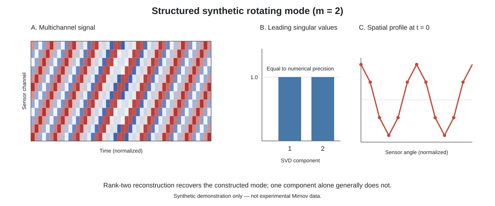

# Plasma Diagnostics Data Analysis: A Provenance-Aware Python Framework for Reproducible Diagnostic Workflows

**Author:** Ramin Alipour  
**ORCID:** https://orcid.org/0000-0003-0744-9866  
**Corresponding author:** alipour_r@ymail.com

## Abstract

Experimental plasma diagnostics produce heterogeneous signals and spectra that require calibration, preprocessing, feature extraction, and quantitative interpretation. When analysis is distributed across one-off scripts, it is difficult to reuse methods, inspect intermediate calculations, trace values to their sources, or distinguish measured data from derived and synthetic quantities. *Plasma Diagnostics Data Analysis* is an open-source Python framework for spectroscopy, hard-X-ray signals, magnetic fluctuations, electrostatic probes, turbulence and transport, and cross-diagnostic analysis. It combines reusable modules with executable notebooks, automated tests, source manifests, and field-level provenance records. Six publication-grounded IR-T1 case workflows (P01–P06) are included. Dataset A contains supplied laboratory and diagnostic-software records; Dataset B contains separately documented values transcribed, digitized, or reconstructed from publications; synthetic signals form a third category used for controlled demonstrations and software tests. These categories remain separate. The version-specific v0.2.2 archive is available from GitHub and Zenodo. Continuous integration on Python 3.11–3.13 tests the code, runs the reconstruction notebooks on Python 3.11, and builds and tests an installed wheel. These checks support reproducible software execution, not independent validation of historical experimental results.

**Keywords:** plasma diagnostics; scientific software; Python; spectroscopy; magnetic fluctuations; signal processing; data provenance

**Highlights**

- Reusable workflows span six IR-T1 diagnostic-analysis case studies.
- Field-level provenance separates supplied, publication-derived, and synthetic data.
- Source discrepancies are preserved rather than adjusted to force agreement.
- Tests verify software behavior, not independent experimental validity.

## 1. Motivation and significance

Plasma-diagnostic analysis is not a single calculation. It typically combines preprocessing, calibration, feature extraction, signal analysis, calculation of physical observables, and comparison with experimental or published constraints. When these steps are scattered across individual scripts and notebooks, researchers may have to reimplement methods, and it becomes harder to inspect intermediate results, trace a value to its source, reproduce a workflow, or identify where a disagreement enters the analysis. Reproducing a published plot alone does not solve these problems.

*Plasma Diagnostics Data Analysis* addresses this software-engineering gap by organizing six publication-grounded IR-T1 cases (P01–P06) into reusable Python workflows spanning optical/Doppler spectroscopy and impurity analysis [1], hard-X-ray observations [2], compound-probe measurements [3], pressure-dependent turbulent transport [4], biased-limiter effects [5], and magnetic/MHD fluctuations [6]. The purpose is not to claim new IR-T1 experiments or to recover unavailable original shots. It is to make selected methods executable and inspectable, preserve the distinction between source data and reconstructed or synthetic inputs, and provide explicit checks for source consistency and software behavior.

The contribution is therefore not the act of reproducing six papers in isolation. It is the combination of diagnostic-specific algorithms, reusable interfaces, runnable examples, automated regression checks, and field-level provenance that lets users inspect how each result was produced. The evidence model distinguishes source-reported values, table transcriptions, figure digitizations, reconstructed values, synthetic inputs, assumptions, and derived quantities. Crucially, it preserves genuine discrepancies instead of forcing agreement: a detected mismatch can trigger investigation, whereas silently editing one dataset to match another would make the workflow less trustworthy. Software tests establish defined computational behavior; they do not, by themselves, establish independent physical validity.

### 1.1. Related software and scope

Several established tools address complementary parts of this landscape. PlasmaPy is a community-developed Python package intended to provide reusable core functionality for plasma research and education [8]. OMFIT provides a framework for exchanging data and coordinating integrated modeling tasks through a common data structure [9]. MDSplus is a long-standing infrastructure for experimental data acquisition, storage, access, and analysis in fusion research [10]. These projects are not treated as missing or inadequate alternatives; their broad and different purposes make a direct feature-by-feature claim of superiority inappropriate.

The present package has a narrower objective: to bundle selected IR-T1 diagnostic calculations and publication-reconstruction examples with explicit separation of supplied laboratory/device-software records, publication-derived values, synthetic test inputs, and derived outputs. It emphasizes field-level provenance and explicit discrepancy reports for these cases. It is not a replacement for experimental data systems such as MDSplus or an integrated modelling environment such as OMFIT. The overlap with PlasmaPy is real: PlasmaPy provides Langmuir-probe analysis, including swept I–V characteristic processing, estimates of plasma potential and electron temperature, density estimates, and EEDF-related functionality [8,9]. The present package does not claim to replace those algorithms. Its electrostatic-probe case focuses on selected compound-probe and flow/Mach-number calculations tied to the IR-T1 case-study data, while the repository-wide contribution is the provenance-aware connection among diagnostic-specific calculations, source manifests, publication comparisons, and tests. No systematic head-to-head benchmark has been performed.

| Capability | PlasmaPy | OMFIT / MDSplus | Present package |
|---|---|---|---|
| General plasma analysis and reusable physics functions | Broad, community-maintained Python toolkit | OMFIT coordinates integrated modelling; MDSplus provides experimental data infrastructure | Selected Python diagnostic calculations, not a general plasma-physics library |
| Langmuir-probe I–V analysis | Dedicated swept-Langmuir analysis is available [8,9] | Depends on installed analysis workflows and data interfaces | Selected IR-T1 compound-probe and flow/Mach calculations; no claim of superior general Langmuir analysis |
| Experimental data acquisition and access | Not its primary role | MDSplus is specifically designed for experimental data storage/access; OMFIT integrates workflows | Not provided |
| Publication-derived A/B comparison and field-level provenance for these six IR-T1 cases | Not the focus of the cited general diagnostics modules | Not claimed as a built-in equivalent | Explicit source manifests, field-level provenance, discrepancy-preserving reports |
| Independent physical validation | Depends on the dataset and method | Depends on the workflow and data | Not established by this release; software tests and source-overlap checks are reported separately |

The table compares stated scope, not performance or overall quality.

## 2. Software description

### 2.1. Architecture and capabilities

The package provides reusable components for:

- **Optical spectroscopy:** wavelength calibration, line identification, Gaussian fitting, and Doppler-broadening calculations.
- **Magnetic diagnostics:** signal preprocessing, power spectral density (PSD), singular-value decomposition (SVD), wavelet-based time-frequency analysis where implemented, and spatial Fourier-mode projections.
- **Electrostatic probes:** probe-oriented calculations and compound-probe flow/Mach-number analysis.
- **Hard-X-ray analysis:** event summaries and energy-spectrum calculations for available tabulated or synthetic inputs; raw detector events and detector-response calibration are not available for independent reconstruction.
- **Turbulence and transport:** fluctuation statistics, electric-field and E×B-related quantities, Reynolds stress, turbulent-flux calculations, and parameter scans.
- **Cross-diagnostic analysis:** time alignment, correlation, and comparative summaries.
- **Reconstruction and provenance:** source manifests, field-level provenance, dataset loaders, audit records, and comparison utilities.

The repository contains reusable package modules, domain notebooks, six publication-reconstruction cases, a dedicated Dataset A P01 laboratory line-width notebook, tests, package metadata, and audit documentation. Notebooks demonstrate the workflows but are not the only implementation of the analysis.

### 2.2. Evidence classes and dataset boundaries

Three evidence classes are maintained separately.

**Dataset A — supplied laboratory and diagnostic-software records.** This set contains a limited collection of owner-supplied laboratory measurements and diagnostic-software outputs. Source records are retained without numerical alteration. Dataset A is not a complete archive of original IR-T1 discharge data. The owner identifies e06_mhd_signal.csv as a diagnostic-software export; its columns (x_pixel, y_pixel, frequency_kHz, and amplitude) do not establish that it is a raw time-domain waveform, so the software does not calculate a time-domain PSD from it without valid waveform and sampling metadata.

**Dataset B — publication-derived records.** This set contains values transcribed from tables or text, digitized from figures, or reconstructed from six IR-T1 publications [1–6]. Source manifests and column-level provenance distinguish exact reported values from approximate digitizations and reconstructed quantities. Dataset B is not Dataset A with noise added.

**Synthetic data — controlled computational inputs.** Synthetic signals exercise algorithms or encode selected constraints. Noise settings are workflow-specific. The synthetic relative-noise regression test uses a 1.3% Gaussian perturbation relative to the nonzero reference magnitude, with exact zero references remaining zero. By contrast, `TurbulenceSyntheticConfig.noise_fraction` defaults to 0.01 (1%) for synthetic density and potential fluctuations. These are configurable demonstration/test settings, not estimates of instrument noise or values inferred from experimental statistics. They apply only to synthetic inputs and do not alter Dataset A or Dataset B.

Several source boundaries are particularly important. For P01, the lead author supplied laboratory measurements that are kept separate from the publication-derived record. The accompanying provenance note states that some publication values were intentionally approximate or different to protect sensitive diagnostic know-how; this explanation has not been independently verified by the software. Accordingly, the records are not treated as interchangeable, and the publication-derived values are not used to overwrite the supplied measurements. Before submission, the author must confirm the right to redistribute Dataset A and specify the applicable data-use terms; the repository's MIT license applies to software code and does not, by itself, license the datasets. The early synthetic CCD-like spectrum was a software-development scaffold, not the experimental dataset; comparisons between that scaffold and publication temperatures are withdrawn from scientific reporting and are not reported as experimental discrepancies. For P02, the Dataset A modal table and the Dataset B transcription of the published table coincide numerically; that overlap is preserved because the two records have different provenance roles, and it is not independent validation. For P04, Dataset A records +0.0010 for radial transport at 2.3 Torr under +200 V, while the source paper text reports −0.0011; both are retained with their provenance rather than silently adjusted. For P06, the digitized pressure-specific PSD peaks are approximate (about 42, 48, and 52 kHz). The Dataset B peak-summary record labels ±3.1 kHz as a combined axis-calibration and peak-selection uncertainty. The comparison code uses that source-reported uncertainty to flag whether the A/B difference falls within the stated range. This manuscript does not independently reconstruct the component uncertainty budget, so the value should be understood as a documented, source-reported estimate rather than a newly calculated confidence interval. These comparisons do not justify treating a digitized curve as a raw time series or forcing agreement with a paper's broader frequency band.

### 2.3. Publication-grounded computational cases

The six cases illustrate different computational paths:

| Case | Domain and demonstration | Main limitation |
|---|---|---|
| P01 | Spectral-line fitting and Doppler-related calculations; separate laboratory-data analysis | Synthetic fitting is a software test, not the experimental spectrum |
| P02 | Hard-X-ray event-energy summaries, synthetic multichannel magnetic signals, and spatial Fourier modes | Original detector response and raw Mirnov time series are unavailable |
| P03 | Directional-current model and Mach-number sensitivity analysis | Original collector-current time series is unavailable |
| P04 | Potential-to-field and transport calculations under pressure and bias conditions | Some intermediate traces are synthetic; reconstructed values are labelled approximate |
| P05 | Parameterized limiter-position and bias scenarios | Scenarios are consistency demonstrations, not new measurements or independent causal inference |
| P06 | Synthetic multichannel fluctuations, PSD analysis, and selected figure digitization | Figure-derived peaks are approximate; pressure-specific comparisons in panels b/c exceed the stated uncertainty |

Synthetic traces are not described as recovered measurements. Agreement with a target used to construct a synthetic signal is a computational consistency check, not independent experimental validation. The software does not infer a physical poloidal mode number merely from an SVD component index.

## 3. Methods and illustrative use

The implementation uses established numerical methods rather than proposing new physical estimators. The following equations specify representative calculations used in the workflows.

For a Gaussian line whose width is attributed to thermal Doppler broadening, the emitter temperature is related to the Doppler full width at half maximum (FWHM) by [11]

\[
\Delta\lambda_D = \frac{\lambda_0}{c}
\sqrt{\frac{8 k_B T \ln 2}{m}}, \qquad
T = \frac{m c^2}{8 k_B \ln 2}
\left(\frac{\Delta\lambda_D}{\lambda_0}\right)^2 .
\]

The observed width can also include instrumental broadening, Stark broadening, Zeeman splitting, and self-absorption (radiation trapping); these effects can bias a temperature inferred from a single Gaussian width. The current workflow fits a Gaussian line profile and evaluates the Doppler relation; it does not jointly forward-model or deconvolve instrumental, Stark, or Zeeman contributions, and it does not model self-absorption. Therefore those effects must be negligible, independently corrected, or explicitly treated by the user before interpreting the result as an ion temperature. The fit output alone does not establish those conditions.

For a multichannel magnetic matrix \(X\in\mathbb{R}^{N_c\times N_t}\), the SVD workflow first optionally subtracts each channel mean and then computes

\[
X = U\Sigma V^{\mathsf T}.
\]

The fraction of squared-singular-value energy assigned to component \(i\) is

\[
p_i = \frac{\sigma_i^2}{\sum_j \sigma_j^2}.
\]

The component index identifies an SVD component, not by itself a physical poloidal mode number. A separate spatial projection or phase-based mode-identification procedure and appropriate sensor geometry are needed for that interpretation [12].

A structured synthetic example illustrates what the SVD calculation can and cannot establish. For sensors at angles \(\theta_j=2\pi j/N_c\), construct a rotating mode \(x_j(t)=A\cos(m\theta_j-\omega t)\) with a known poloidal mode number \(m\). For an integer number of periods and evenly spaced sensors, its cosine and sine quadratures span a two-dimensional subspace; their singular values are equal up to numerical precision. A rank-two reconstruction recovers the constructed mode, while a rank-one reconstruction generally does not recover the full rotating wave.

A minimal example of the implemented SVD API is:

```python
import numpy as np
from magnetic_diagnostics.svd import compute_svd

# Synthetic demonstration only: four channels by 1024 samples.
# Replace this array with calibrated, time-aligned channel data for analysis.
signals = np.random.default_rng(0).normal(size=(4, 1024))
result = compute_svd(signals, center=True, scale=False)

explained_energy = result.explained_energy
first_component = result.temporal_components[0]
reconstruction = result.reconstruct(n_components=1)
```

Here, `signals` must be a finite two-dimensional channels-by-time array. `SVDResult.reconstruct(n_components=2)` returns the centered/scaled analysis matrix reconstructed from two components; when `center=True`, it does not restore the original channel means. The rank-two example and the figure are synthetic demonstrations, not measured Mirnov data or independent mode validation.



**Figure 1.** Synthetic rotating mode with known \(m=2\). The equal leading singular values reflect the two temporal quadratures of the constructed signal. The spatial profile is recovered by retaining both components; this controlled example verifies implementation behavior, not physical validity on an experimental discharge.

For directional probe currents, a reduced relation is often written \(M=\ln(R)/K\), where \(R=I_{\mathrm{up}}/I_{\mathrm{down}}\) and the calibration factor \(K\) depends on probe geometry, magnetic-field alignment, ion temperature, and plasma conditions [14]. This is a model-dependent approximation, not a universal calibration. The package's P03 case is a model-constrained reconstruction; it is not a calibration of an independent raw-current series.

A typical end-to-end workflow loads a dataset using provenance-aware functions, checks its source manifest and field-level records, applies reusable analysis functions, compares outputs only with relevant source constraints, and runs the corresponding tests or notebook. The P01 laboratory notebook analyzes supplied measurements separately from synthetic line-fitting tests. For magnetic/MHD examples, a multichannel matrix is analyzed with SVD/PSD and, where justified by geometry and input metadata, spatial Fourier projections. For turbulence/transport examples, parameterized inputs demonstrate the calculation chain while reported text values remain separate from approximate reconstructions. Intermediate steps are available for inspection, and source records remain traceable through manifests and provenance metadata.

## 4. Impact, verification, and limitations

The practical impact is that researchers can reuse selected diagnostic-analysis components, inspect intermediate calculations, and rerun six case workflows within one versioned software distribution. The software includes six publication-grounded case workflows (P01–P06); this is a description of scope, not a numerical validation score. The source-comparison checks illustrate why the distinction matters: P01, P02, and P03 contain exact overlaps with publication tables or reported parameters, which are source-consistency checks rather than independent validation; P04 preserves a source discrepancy in one of 30 shared-field comparisons; P05 checks both direction and magnitude for four reported effects; and P06 distinguishes reported timing constraints from approximate figure-digitized frequency estimates. These outcomes make the scope and limits of each comparison visible. The shared-field count is descriptive bookkeeping only; it is not an inferential statistic and is not used as a measure of scientific validity. The project does not claim external adoption, quantified time savings, or improved physical inference; those claims would require independent-user studies or validation against separately documented experimental datasets.

The cited software version is archived as v0.2.2 [7]. Continuous integration on the released source commit 5fa9b58b43b3461135404ef84db7bd434a31e5c4 passed on Python 3.11, 3.12, and 3.13. The Python 3.11 job executed the reconstruction notebooks; all three jobs completed tests, compilation, import checks, and installed-wheel checks. The corresponding CI run is [38174480297](https://github.com/Ramin-Alipour/plasma-diagnostics-data-analysis/actions/runs/38174480297). The release-packaging workflow also passed, built the source distribution and wheel, created the source ZIP and checksum file, and attached the four assets to the GitHub release [run 38174480392](https://github.com/Ramin-Alipour/plasma-diagnostics-data-analysis/actions/runs/38174480392).

These checks establish software execution, packaging, and selected computational consistency. They do not independently validate historical IR-T1 measurements, verify unavailable acquisition logs, recover missing raw shots, or convert synthetic constraints into new experimental findings. Dataset B values digitized from figures or reconstructed from incomplete publication information may be approximate. For P06, the table-based pressure-frequency comparison and the separate comparison with digitized Figure 2 peaks are different checks and must not be conflated; both retain their respective differences. The current ±3.1 kHz threshold is only an operational screening tolerance, and a defensible uncertainty budget remains future work. Dataset A is a limited supplied record set rather than a full acquisition archive, and confidential client datasets are not distributed.

## 5. Conclusions

*Plasma Diagnostics Data Analysis* provides six implemented and assessed publication-grounded case workflows (P01–P06) across major plasma-diagnostic analysis domains. Its main contribution is not simply reproducing previously published numbers or plots, but packaging reusable analysis procedures with runnable examples, regression checks, and explicit provenance for source-reported, transcribed, digitized, reconstructed, derived, and synthetic values. The case audits show that numerical agreement is not universal and should not be manufactured: one P04 source discrepancy is retained, and P06 figure-derived frequency differences remain explicitly approximate. Together with automated execution and packaging checks, this gives users a more inspectable basis for reusing and adapting diagnostic workflows. The current evidence supports claims of software coverage, reproducible execution, and documented consistency checks—not independent validation of historical measurements or new experimental discoveries.

## Software availability and metadata

| Code metadata | Description |
|---|---|
| Current code version | 0.2.2 |
| Permanent link to the code version | https://github.com/Ramin-Alipour/plasma-diagnostics-data-analysis/releases/tag/v0.2.2 |
| Version-specific archive DOI | https://doi.org/10.5281/zenodo.23300661 |
| Repository | https://github.com/Ramin-Alipour/plasma-diagnostics-data-analysis |
| Legal code license | MIT |
| Versioning system | Git |
| Language and tools | Python; NumPy, SciPy, Matplotlib, pandas; pytest and Jupyter for development/testing |
| Requirements and environment | Python ≥ 3.11; CI on Python 3.11–3.13; notebook execution on Python 3.11 |
| Documentation | https://github.com/Ramin-Alipour/plasma-diagnostics-data-analysis |
| Support contact | alipour_r@ymail.com |

**Installation:** `python -m pip install "plasma-diagnostics-data-analysis @ https://github.com/Ramin-Alipour/plasma-diagnostics-data-analysis/releases/download/v0.2.2/plasma_diagnostics_data_analysis-0.2.2-py3-none-any.whl"`  
**Tests from a source checkout:** `python -m pip install -e ".[dev]" && python -m pytest`

## CRediT authorship contribution statement

Ramin Alipour: Conceptualization, Software, Methodology, Formal analysis, Data curation, Visualization, Writing – original draft, Writing – review and editing.

## Declaration of competing interest

The author declares no known competing financial interests or personal relationships that could have appeared to influence the work reported in this paper.

## Funding

The author must confirm the funding statement before submission. No funding source is asserted in this draft.

## Declaration of generative AI and AI-assisted technologies in the manuscript preparation process

During the preparation of this manuscript, the author used ChatGPT (OpenAI) to assist with drafting, organization, and language editing. The author reviewed and edited the manuscript and takes full responsibility for its content.

## Data availability

The source code is released under the MIT license. The software, source manifests, provenance records, and included datasets are currently present in the public repository and the version-specific Zenodo archive identified above. Dataset A contains a limited set of supplied laboratory and diagnostic-software records; Dataset B contains separately documented publication-derived values. Neither is presented as a complete archive of original IR-T1 raw shots, and confidential client datasets are not included. The repository does not currently specify a separate license for the datasets. Before journal submission or any claim of unrestricted data reuse, the author must confirm the permission and terms for redistributing Dataset A and add an explicit data-licensing statement; the MIT code license must not be interpreted as a dataset license.

## Acknowledgements

The author must confirm before submission whether any acknowledgements are required.

## References

1. Alipour, R., Ghoranneviss, M., & Elahi, A. S. (2017). First investigation on plasma impurities of the IR-T1 Tokamak. *AIP Advances*, 7(11), 115303. https://doi.org/10.1063/1.4990869
2. Alipour, R., Ghoranneviss, M., & Elahi, A. S. (2017). Investigation on the Hard X-ray Radiations of the IR-T1 Tokamak Plasma: Electric and Magnetic Perspectives. *Brazilian Journal of Physics*, 47, 567–574. https://doi.org/10.1007/s13538-017-0536-6
3. Alipour, R., Ghoranneviss, M., & Elahi, A. S. (2017). Design and fabrication of a new compound probe for plasma flux measurement in IR-T1 tokamak. *Review of Scientific Instruments*, 88, 093516. https://doi.org/10.1063/1.4994037
4. Alipour, R., Meshkani, S., Elahi, A. S., & Ghoranneviss, M. (2017). Investigation on the effect of pressure on turbulent transports of the IR-T1 Tokamak plasma. *The European Physical Journal D*, 71, 60. https://doi.org/10.1140/epjd/e2017-70563-6
5. Alipour, R., Ghoranneviss, M., Elahi, A. S., & Meshkani, S. (2017). Effects of the location of a biased limiter on turbulent transport in the IR-T1 tokamak plasma. *The European Physical Journal D*, 71, 228. https://doi.org/10.1140/epjd/e2017-80215-6
6. Alipour, R., & Ghanbari, M. R. (2018). Magnetic evaluation of hydrogen pressure changes on MHD fluctuations in IR-T1 tokamak plasma. *The European Physical Journal D*, 72, 75. https://doi.org/10.1140/epjd/e2018-90033-y
7. Alipour, R. *Plasma Diagnostics Data Analysis*, version 0.2.2 [software]. Zenodo; 2026. https://doi.org/10.5281/zenodo.23300661
8. PlasmaPy Community. *PlasmaPy diagnostics: Langmuir and other diagnostic analysis modules*. Official documentation. https://docs.plasmapy.org/en/stable/ad/diagnostics/index.html
9. PlasmaPy Community. *Langmuir analysis*. Official documentation. https://docs.plasmapy.org/en/stable/ad/diagnostics/langmuir.html
10. Meneghini, O., & Lao, L. (2013). Integrated Modeling of Tokamak Experiments with OMFIT. *Plasma and Fusion Research*, 8, 2403009. https://doi.org/10.1585/pfr.8.2403009
11. Stillerman, J. A., Fredian, T. W., & Klare, K. (1999). The MDSplus data acquisition system, current status and future directions. *Fusion Engineering and Design*, 43(3–4), 301–308. https://doi.org/10.1016/S0920-3796(98)00398-6
12. Griem, H. R. (1997). *Principles of Plasma Spectroscopy*. Cambridge University Press. https://doi.org/10.1017/CBO9780511524579
13. Kim, J. S., Edgell, D. H., Greene, J. M., Strait, E. J., & Chance, M. S. (1999). MHD mode identification of tokamak plasmas from Mirnov signals. *Plasma Physics and Controlled Fusion*, 41(11), 1399–1420. https://doi.org/10.1088/0741-3335/41/11/307
14. Nardone, C. (1992). Multichannel analysis of MHD fluctuations by the singular value decomposition method. *Plasma Physics and Controlled Fusion*, 34, 1447–1465. https://doi.org/10.1088/0741-3335/34/9/1447
15. Hutchinson, I. H. (1987). *Principles of Plasma Diagnostics*. Cambridge University Press. https://doi.org/10.1017/CBO9780511613630
